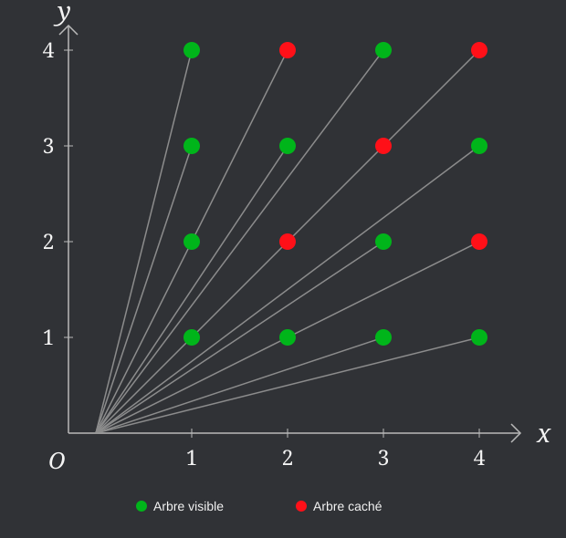

## Exercice : les arbres visibles

On considère un verger dont les arbres occupent tous les points
$(x,y)\in\mathbb{(N^*)}^2$ du quart de plan positif

Un observateur est placé à l'origine $O=(0,0)$

Un arbre est dit visible si aucun autre arbre ne se trouve sur la demi-droite reliant $O$ à cet arbre

Quelle est la proportion d'arbres visibles ?

Ci-dessous, on représente le cas $N=4$

(voir la vidéo pour la solution)

